# Informe de Verificación y Pruebas — `reservas-app`

**Estudiante:** Juan Alfredo Santana (`jsantana` / `alfredosantana94`)  
**Namespace:** `reservas-app`  
**Release de Helm:** `reservas-release`

---

## 1. Aplicación respondiendo a través del Ingress y reserva desde el navegador

Se verificó la conectividad hacia el clúster, el estado de la release desplegada por Helm (`reservas-release`), el recurso Ingress (`reservas.local`), la respuesta de la API y la creación/persistencia de reservas desde el navegador.

* **Comando `kubectl config current-context`:**
  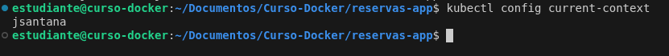
  *Se observa el contexto `jsantana` configurado para operar sobre el clúster.*

* **Comando `sudo wg show vpn-curso`:**
  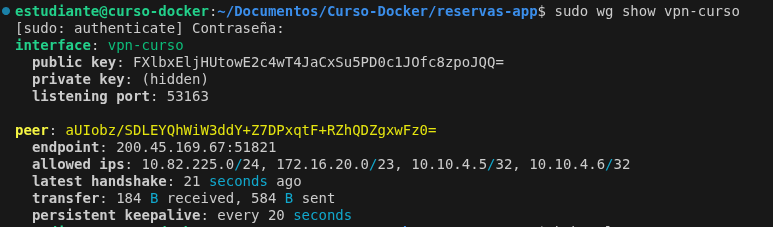
  *Se observa la interfaz `vpn-curso` activa con enlace establecido hacia el endpoint del curso.*""

* **Comando `helm list -n reservas-app`:**
  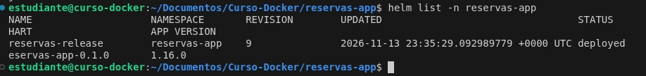
  *Se observa la release `reservas-release` (revisión 9) en estado `deployed` con el chart `reservas-app-0.1.0`.*""

* **Comando `kubectl get all,ingress,hpa -n reservas-app`:**
  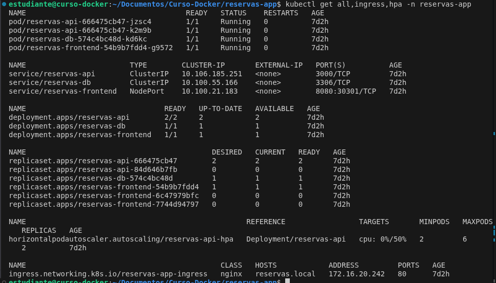
  *Se observa el recurso `ingress.networking.k8s.io/reservas-app-ingress` en `reservas.local` (`172.16.20.242`) junto con los pods, servicios y HPA activos.*""

* **Comando `curl -s [http://reservas.local/api/reservas](http://reservas.local/api/reservas)`:**
  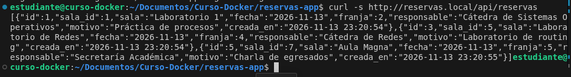
  *Se observa la respuesta JSON devuelta por el endpoint `/api/reservas` a través del Ingress. *""

* **Acceso desde el navegador (`http://reservas.local`):**
  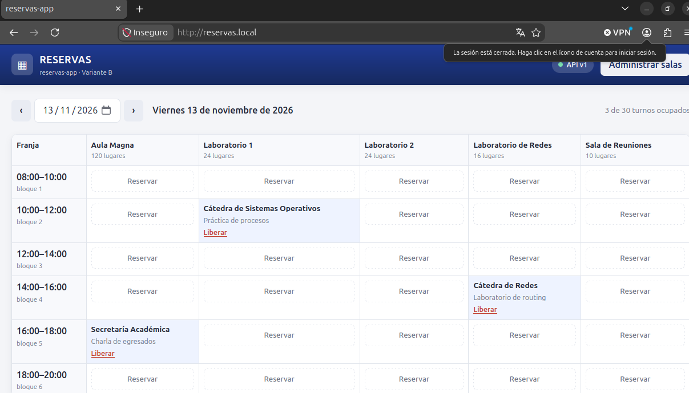
  *Se observa la interfaz web cargando por `[http://reservas.local](http://reservas.local)` con las reservas previas del 13/11/2026 persistidas.*""

  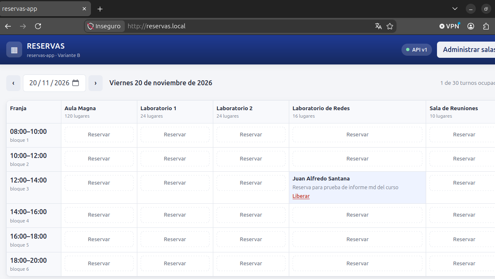
  *Se observa la nueva reserva creada desde el navegador ("Juan Alfredo Santana — Reserva para prueba de informe md del curso") en `[http://reservas.local](http://reservas.local)`.*""

---

## 2. Escalado y descenso del HPA sobre la release de Helm

Se observó el comportamiento del `HorizontalPodAutoscaler` (`reservas-api-hpa`) gestionado por la release de Helm al aplicar carga continua contra `http://reservas-api:3000/reservas` y al detenerla posteriormente"".

* **Comando `kubectl get hpa -w -n reservas-app` (inicio):**
  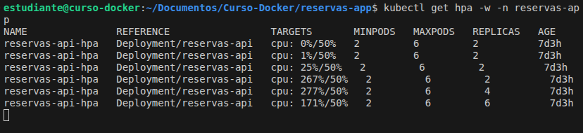
  *Se observa `reservas-api-hpa` en su estado inicial con 2 réplicas (`MINPODS: 2`, `MAXPODS: 6`, objetivo `cpu: 50%`).*""

* **Creación de pods generadores de carga (`kubectl run carga-1` / `carga-2`):**
  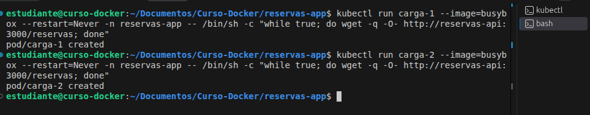
  *Se observa la creación de los pods `carga-1` y `carga-2` enviando peticiones continuas a `http://reservas-api:3000/reservas`.*""

* **Comando `kubectl get hpa -w -n reservas-app` (escalado ascendente y descendente):**
  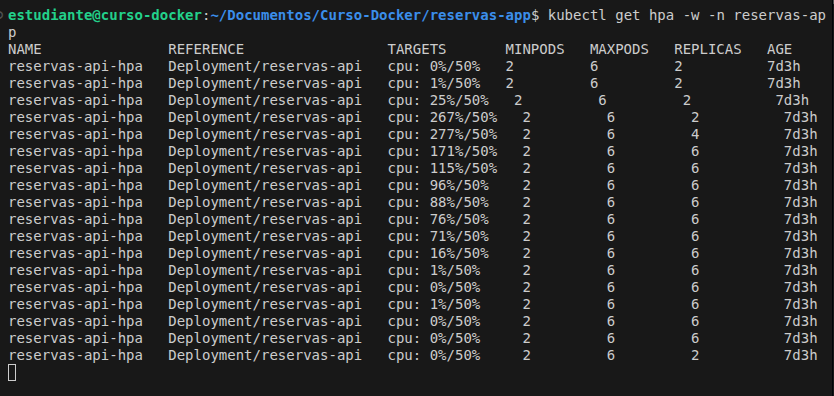
  *Se observa el incremento del CPU (`0%/50%` hasta `277%/50%`) haciendo subir las réplicas de `2` a `4` y `6`, y el posterior descenso de `6` a `2` réplicas tras cesar la carga.*""

* **Comando `kubectl delete pod carga-1 carga-2 -n reservas-app`:**
  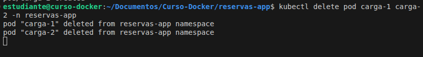
  *Se observa la eliminación de `carga-1` y `carga-2` para detener la generación de tráfico.*""

---

## 3. Salida de `helm history` tras actualización y reversión

A partir de las pruebas realizadas sobre la release `reservas-release`, se actualizó la versión de la API a `v2` (`helm upgrade`), se verificó el cambio en el navegador y se revirtió a la revisión anterior (`helm rollback`)"".

* **Actualización con `helm upgrade` a `v2`:**
  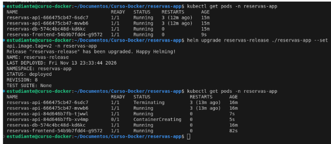
  *Se observa la actualización de la release a la versión `v2` (`REVISION: 8`) y el reemplazo progresivo de los pods.*""

  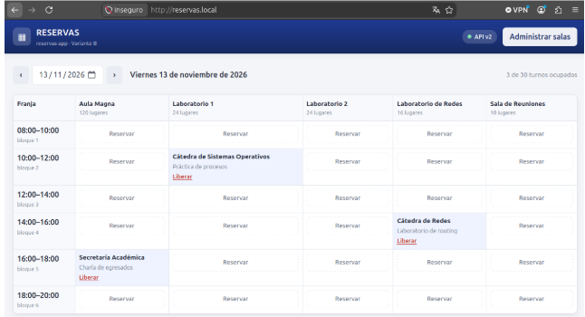
  *Se observa el badge `API v2` activo en la aplicación web en `http://reservas.local`.*""

* **Reversión con `helm rollback` y consulta de `helm history`:**
  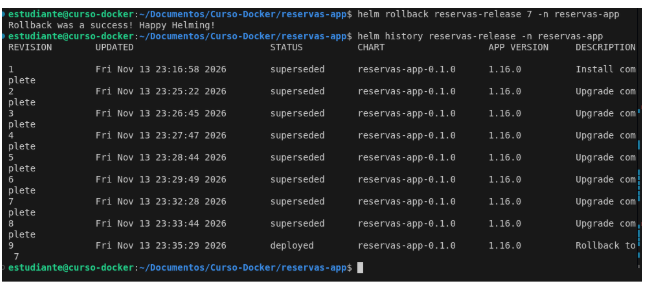
  *Se observa la ejecución de `helm rollback reservas-release 7 -n reservas-app` y la salida de `helm history reservas-release -n reservas-app` con las revisiones anteriores en `superseded` y la revisión 9 en `deployed` (`Rollback to 7`).*""

---

## 4. Prueba de parámetro real en `values.yaml` con `helm template`

Se renderizó la plantilla `templates/deploy-reservas-api.yaml` dos veces con valores distintos para comprobar que los parámetros del `values.yaml` modifican efectivamente el manifiesto generado.

* **Comandos ejecutados:**
  ```bash
  helm template reservas-app ./reservas-app --show-only templates/deploy-reservas-api.yaml | grep -E "name:|replicas:|image:"
  helm template reservas-app ./reservas-app --set api.replicaCount=5 --set api.image.tag=v2 --show-only templates/deploy-reservas-api.yaml | grep -E "name:|replicas:|image:"

* **Evidencia:**
  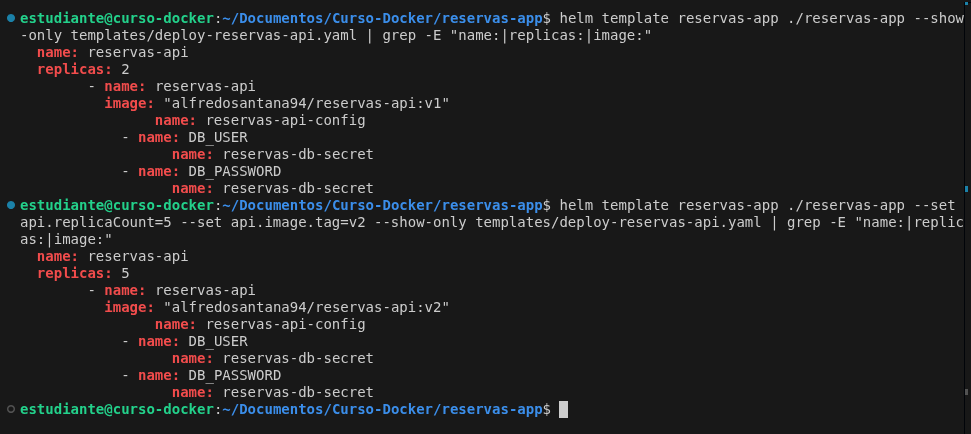
  *Se observa que el manifiesto renderizado cambia de `replicas: 2` e `image: "alfredosantana94/reservas-api:v1"` a `replicas: 5` e `image: "alfredosantana94/reservas-api:v2"` al sobrescribir los parámetros con `--set`.*

## 5. Prueba de concurrencia con 3 réplicas

Como respaldo a la prueba de concurrencia con múltiples réplicas ante reservas simultáneas para la misma sala, fecha y franja, se incluye la evidencia de 30 solicitudes `POST` en paralelo y la verificación en MySQL.

- **Evidencia:**
  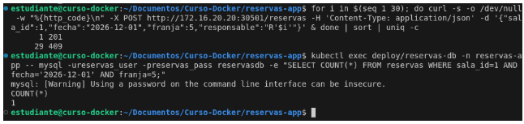
  *Se observa `1` respuesta `201`, `29` respuestas `409` y `COUNT(*) = 1` en la tabla `reservas` para `sala_id=1`, `fecha='2026-12-01'` y `franja=5`.*